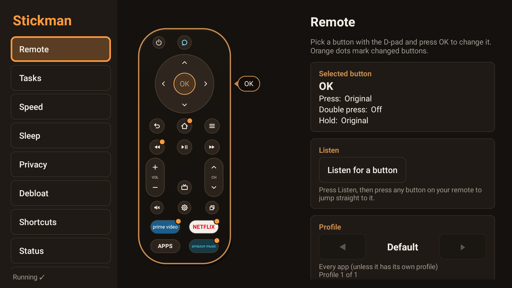
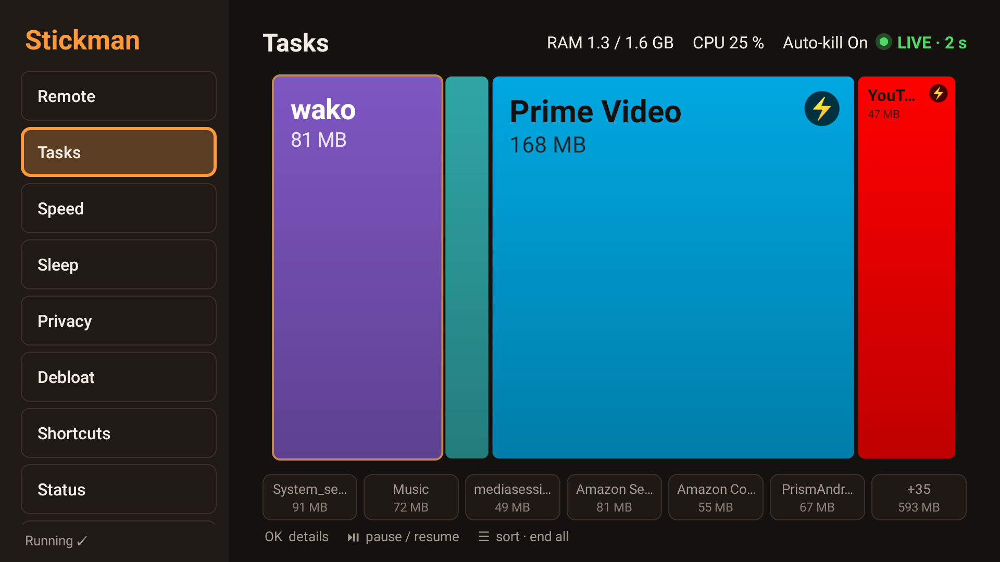
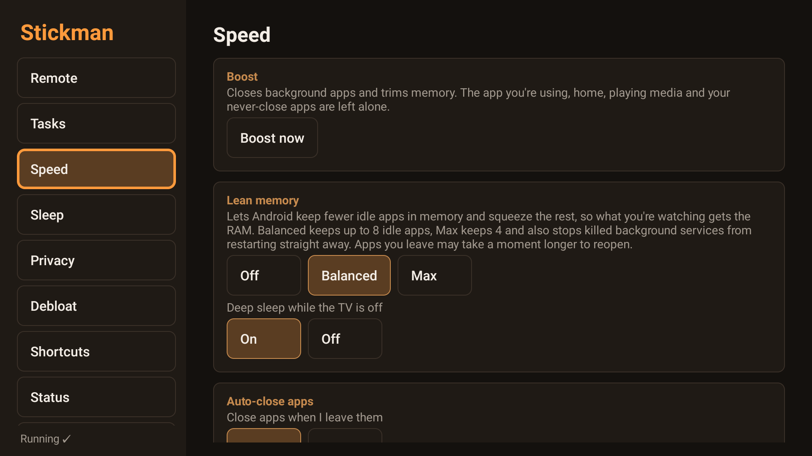
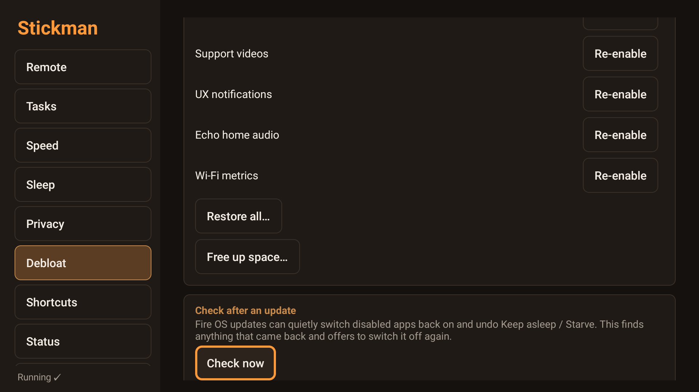

# Stickman

A no-root power remote and stick manager for Amazon Fire TV.

- **Remap any remote button** to any app or action: press, double press and hold, and different buttons inside one app if you like. The original action never fires and the new one is instant, with no 5-second delay and no Amazon home screen flash.
- **No root, no computer.** Stickman gets shell access on the stick itself through a small local VPN that only carries its own commands.
- **Makes the stick lighter:** frees RAM, reclaims storage and debloats Amazon extras, and everything can be undone.

Tested on a Fire TV Stick 4K Max (Fire OS 8).

## Screenshots

| Remote | Tasks |
|---|---|
|  |  |
| **Speed** | **Debloat** |
|  |  |

## Features

- **Remote**: press, double press and hold, different buttons inside one app, presets for every Fire TV remote, and learning for unknown buttons. Any button can open an app, act as another key, or run an action: Boost, sleep timer, screen off, screenshot, media controls, close the current app.
- **Tasks**: a live map of running apps sized by RAM, with End, Always kill and Protect.
- **Speed**:
  - Boost and auto-close.
  - Use recommended settings: one press applies the sensible defaults (Lean memory Balanced, background CPU limit, deep sleep, fewer wake-ups, trim when the TV sleeps).
  - **Trim**: every app that isn't in front gives back the memory it doesn't need, nothing is closed; also automatically when the TV sleeps or on a timer.
  - **Lean memory**: Android keeps fewer idle apps in memory and compresses the rest.
  - **Background CPU limit**: a background app that keeps hogging the CPU is closed by Android within a minute.
  - **Fewer wake-ups**: repeating alarms at most every 15 minutes, two background jobs at a time.
  - **Deep sleep** while the TV is off.
  - **Keep asleep / Starve** any app, picked from your apps, Amazon's services, the apps that **start at boot**, or who actually **ran in the background** over the last 3 hours.
- **Debloat**:
  - About 37 recommended Amazon extras, with one-press Disable all.
  - **Free up space**: removes the updates Amazon keeps downloading for disabled apps.
  - **Clear app caches** and trim the storage.
  - **Check after an update**: switches off again anything an update turned back on.
  - **Uninstall Amazon apps**: Amazon's own list of removable apps (Silk, Amazon Music, miniTV, Photos, ...), with sizes; Stickman opens Amazon's page and you press Uninstall. **Downloaded updates** removes the full downloaded copy of switched-off Amazon apps.
  - **Freeze updates (OTA)**: stops Fire OS system updates until you unfreeze. The updater is protected, so Stickman suspends it instead of disabling it and re-applies the freeze at boot; Appstore app updates are unaffected.
- **Sleep**: sleep timer with fade, screen off with audio on, stay awake while media plays, HDMI-CEC switch.
- **Privacy**: ad-blocking private DNS that switches itself off if the internet breaks, limit ads and tracking (Amazon's own usage-data switches included), a location switch, and **Quiet telemetry**: the eight Amazon reporting apps Fire OS won't let you disable are kept from running in the background, journaled like everything else.
- **Shortcuts** to hidden Amazon settings, and a **Status** page that says whether Stickman is working, what to do if it isn't, and what it has been doing, in plain words.
- **Updates itself** (from 1.9): when a new version is out, Stickman shows what's new and asks: Update now, Always update automatically (installs while the TV is asleep), or Not now. Settings → Updates has Check now and the automatic on/off switch. Only this repository's releases are used, and Android refuses any APK not signed like the installed one.

## Install

1. **Settings, My Fire TV, About**: press OK on the device name 7 times to unlock Developer options.
2. **Developer options**: turn on **ADB debugging**, and allow **Downloader** to install apps.
3. In **Downloader**, open `https://github.com/MohamedNofal/stickman/releases/latest/download/stickman.apk` and install it.
4. Open Stickman, accept the **VPN request**, then tick **Always allow** on "Allow USB debugging?". Wake the TV first if the screensaver is on. If a step was missed, Stickman says which one and what to do.

Keep ADB debugging on: Stickman talks to the TV's own debugging service. From 1.9 on, Stickman updates itself; you only install by hand once.

## Safety

- **Emergency release:** hold **Back for 10 s**.
- Stickman never touches the launcher, Settings, remote services, or whatever is playing. The system updater is only touched by the opt-in **Freeze updates (OTA)**.
- Every change is recorded. **Settings, Undo everything** turns Stickman off and puts the stick back the way it was; **Restore defaults** puts the stick back but keeps Stickman on. The record survives an uninstall, so a reinstall can still restore.

## More

- How it works (VPN self-ADB, remapd, stickd) and how to build it: [docs/how-it-works.md](docs/how-it-works.md)
- MIT licence. Icon credits: [art/SOURCE.md](art/SOURCE.md)
